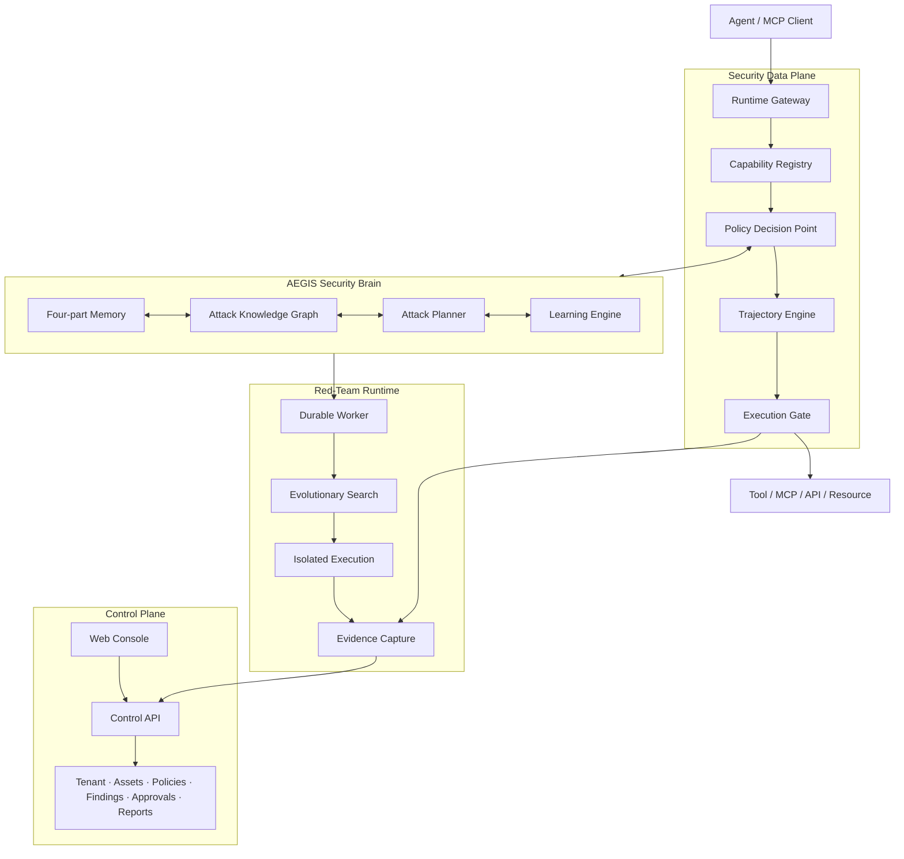
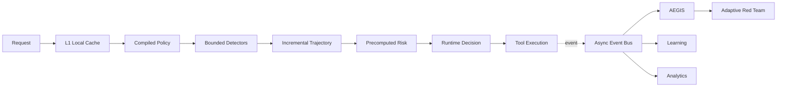

# AgentGuard Enterprise v3.1

**Runtime defense, autonomous red teaming, and evidence-driven security for AI agents and MCP ecosystems.**

AgentGuard is an AI agent security platform designed to inspect model traffic, proposed tool calls, MCP interactions, and multi-step agent behavior. The Enterprise v3.1 architecture combines ultra-low-latency runtime enforcement with asynchronous security intelligence, adaptive attack research, security memory, human approval, and enterprise governance.

> **Development status:** Foundation scaffold. The Enterprise v3.1 directories and integration boundaries are defined, but their files are intentionally empty until their assigned developers implement them. The Python files at the repository root and under `core/` are the earlier research prototype and remain as a behavioral reference.

## Vision

AgentGuard is intended to provide one security layer for:

- runtime policy enforcement;
- MCP and tool-call protection;
- autonomous red-team campaigns in authorized environments;
- adaptive attack amplification;
- multi-step trajectory analysis;
- attack knowledge and vulnerability memory;
- evidence-backed findings and regression verification;
- tenant-aware governance, approvals, and reporting.

The governing principle is:

> **Learning autonomy does not grant privilege autonomy.**

AEGIS may generate hypotheses, attack variants, detector candidates, and policy proposals. It may not expand production permissions, access secrets, weaken policy, enable destructive tests, deploy itself, or alter audit history without the required governance and human approval.

## Target Architecture



## Runtime Decision Flow

```text
Agent or MCP client
  → Runtime Gateway
  → normalized SecurityEvent
  → identity, tenant, and environment context
  → explicit tool capability metadata
  → deterministic detectors + trajectory risk + behavioral signals
  → Policy Decision Point
  → ALLOW | BLOCK | REQUIRE_APPROVAL | SANDBOX | REDACT | STEP_UP_AUTH
  → Execution Gate
  → evidence, telemetry, and learning event
```

Tool permissions must come from explicit capability metadata. Production logic must not infer authority from a tool name. Unknown capabilities in critical contexts are not implicitly trusted.

## v3.1 Runtime Performance Architecture

The fundamental v3.1 rule is:

> **Security intelligence is asynchronous. Security enforcement is real-time. No blocking AI runs on the runtime hot path.**

The hot path is limited to bounded operations: identity and tenant lookup, capability lookup, compiled-policy evaluation, deterministic detectors, incremental trajectory updates, precomputed AEGIS risk, approval-token lookup, and bounded CPU work.



Initial latency SLO targets, to be verified by benchmarks, are `p50 < 2 ms`, `p95 < 5 ms`, `p99 < 10 ms`, and a critical maximum target below `20 ms` under normal production load.

Runtime lookup follows `L1 process memory → L2 Redis → L3 PostgreSQL/source of truth`. Normal requests should complete from L1 whenever possible; L3 is not a normal hot-path dependency. Cache invalidation is event-driven.

Policies follow `validate → version → compile → optimize → hash/sign → publish → runtime cache`. Runtime enforcement consumes compiled artifacts and does not parse policy JSON on every request.

Heavy reasoning, full graph traversal, training, analytics, reporting, and adaptive red-team work run on the intelligence path. When deeper analysis is required, policy returns `REQUIRE_APPROVAL`, `SANDBOX`, `STEP_UP_AUTH`, or `ASYNC_DEEP_ANALYSIS` instead of blocking a normal request.

## Repository Layout and Ownership

| Path | Responsibility | Primary owner |
| --- | --- | --- |
| `apps/control-api/` | Tenant, workspace, users, assets, policies, findings, approvals, reports, and integrations API | Developer B — Platform / Enterprise |
| `apps/runtime-gateway/` | Event normalization, security context, enforcement, execution gating, MCP gateway, and evidence capture | Developer A — Core Security / AEGIS |
| `apps/worker/` | Durable red-team, learning, regression, reporting, sandbox, safety budget, and kill-switch jobs | Shared boundary; ownership follows the job domain |
| `apps/web-console/` | Enterprise management and security operations interface | Developer B — Platform / Enterprise |
| `packages/aegis/` | Memory, planner, learning, adaptive attacks, vulnerability DNA, regression, and self-governance | Developer A |
| `packages/policy/` | PEP/PDP, capability registry, and risk budgets | Developer A |
| `packages/detectors/` | Runtime, trajectory, and behavioral detectors | Developer A |
| `packages/attack-graph/` | Attack knowledge graph and persistence boundary | Developer A |
| `packages/evidence/` | Evidence capture, validation, and integrity | Developer A |
| `packages/domain/`, `packages/contracts/` | Shared domain types and contract validation | Shared; contract changes require coordination |
| `packages/auth/`, `packages/observability/` | Identity, access control, audit, tracing, and metrics | Developer B |
| `schemas/` | Versioned contracts between all deployable units | Shared integration boundary |
| `infra/`, `migrations/` | Deployment and persistent data infrastructure | Developer B |
| `benchmarks/` | Runtime, policy, serialization, and trajectory performance verification | Shared; Developer A owns hot-path targets |
| `tests/` | Contract, integration, tenant-isolation, and adversarial security suites | Shared |
| `core/`, `app.py`, `main.py` | Legacy Python research prototype | Reference during v3 migration |

Detailed scope and handoff expectations are documented in [README_DEVELOPER_A.md](README_DEVELOPER_A.md) and [README_DEVELOPER_B.md](README_DEVELOPER_B.md).

## Shared Contracts

The following schemas are the mandatory integration points between the core security and platform workstreams:

- `SecurityEvent` and `LearningEvent`;
- `PolicyDecision`;
- `ToolCapability`;
- `Finding`;
- `Evidence`;
- `TenantContext`;
- `ApprovalRequest` and `ApprovalDecision`.
- compiled policy artifacts, cache invalidation events, runtime decisions, risk profiles, and worker job envelopes.

Contract changes require a version increment, migration note, backward-compatibility assessment, and notification to the other owner. Core Security must never infer tenant context. The Control Plane must never reproduce runtime security decisions in UI logic.

## Data Architecture

The proposed foundation uses:

| System | Intended responsibility |
| --- | --- |
| PostgreSQL | Tenants, users, assets, policies, findings, approvals, and configuration |
| Redis | Runtime cache, rate limits, active trajectories, and distributed locks |
| Redpanda or Kafka | Security events, learning events, and worker jobs |
| ClickHouse | High-volume telemetry and runtime analytics |
| S3-compatible storage | Evidence, reports, artifacts, and dataset snapshots |

All persistent records must carry tenant context. Cross-tenant isolation tests are required before the platform can be treated as tenant-safe. PostgreSQL, analytics, learning, reporting, and broker acknowledgements must not become synchronous dependencies of the normal runtime hot path.

## Current Prototype

The legacy Python prototype currently demonstrates:

- a Streamlit security-audit dashboard;
- five static adversarial test vectors;
- heuristic SQL, filesystem, and network call inspection;
- an in-memory action trajectory graph;
- genetic prompt mutation and response scoring;
- LiteLLM model access;
- FastAPI and WebSocket integration examples;
- PDF audit report generation.

These components are exploratory. Regex matches and heuristic scores are signals for review, not a complete security boundary, compliance assessment, or certification.

### Run the Legacy Prototype

Use Python 3.12 and create a fresh virtual environment:

```bash
python -m venv .venv
python -m pip install -r requirements.txt
```

Start the dashboard:

```bash
python -m streamlit run app.py --server.address 127.0.0.1
```

Start the API:

```bash
python -m uvicorn main:app --reload --host 127.0.0.1 --port 8000
```

The API documentation is then available at `http://localhost:8000/docs`. Live fuzzing requires an authorized model-provider account and credentials stored outside version control.

## Foundation Definition of Done

The v3.1 foundation is complete only when the platform has tenant-aware persistence, a horizontally scalable stateless runtime gateway, mandatory capability metadata, explainable compiled-policy decisions, bounded deterministic detectors, incremental trajectory state, precomputed AEGIS risk, durable asynchronous workers, evidence-backed findings, regression replay, governed detector releases, cross-tenant and noisy-neighbor isolation, tamper-evident audit records, an operational kill switch, and benchmarked latency SLOs.

Production changes must move through testing, historical evaluation, sandbox execution, shadow mode, canary release, human approval, a signed artifact, and a reversible deployment.

## Development with Coding Agents

All human developers and coding agents must read [the v3.1 master architecture](README_MASTER_ARCHITECTURE_v3.1.md) and [AGENTS.md](AGENTS.md) before making changes. They define architectural boundaries, ownership, contract rules, latency requirements, security invariants, and the expected handoff format.

## Responsible Use

Run adversarial campaigns only against explicitly authorized targets and environments. Every campaign should define its targets, network scope, time window, concurrency and request budgets, data-handling rules, destructive permissions, and kill switch. The default operating mode is non-destructive.

This repository is private. No open-source license has been selected.
