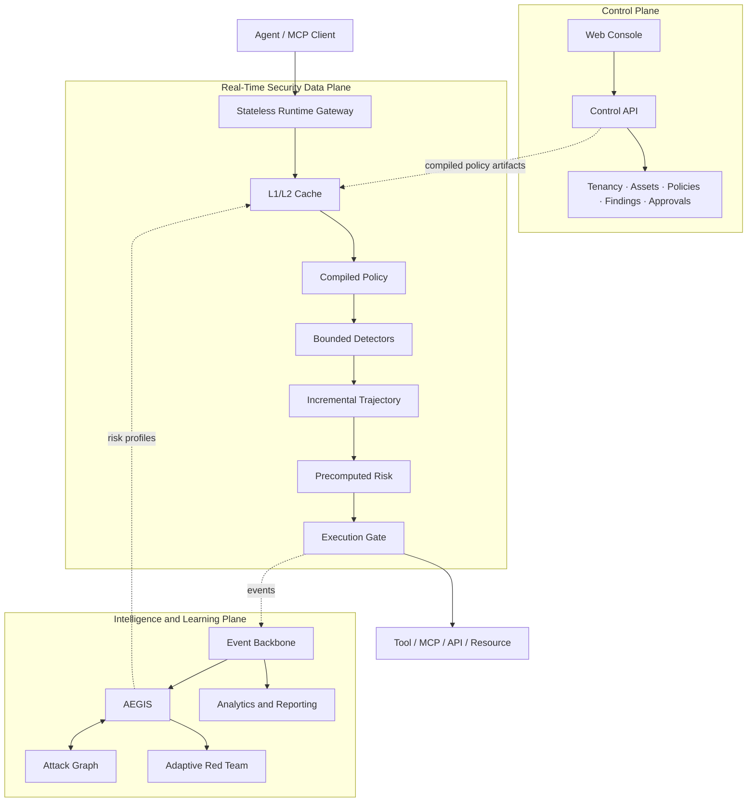

# AgentGuard Enterprise v3.1 Architecture

This document is a concise technical companion to the canonical [master architecture](../README_MASTER_ARCHITECTURE_v3.1.md). It describes the target architecture and current repository boundaries. Planned components are not implemented merely because placeholder files exist.

## Architectural Law

```text
SECURITY INTELLIGENCE IS ASYNCHRONOUS.
SECURITY ENFORCEMENT IS REAL-TIME.
NO BLOCKING AI ON THE RUNTIME HOT PATH.
```

AgentGuard separates the real-time Security Data Plane from the Intelligence and Learning Plane. This separation protects enforcement latency from model reasoning, red-team expansion, graph traversal, training, analytics, and reporting workloads.

## Planes and Deployable Units



The initial deployable units remain deliberately coarse-grained:

- `apps/control-api/` for the enterprise control surface;
- `apps/runtime-gateway/` for real-time enforcement;
- `apps/worker/` for durable asynchronous work;
- `apps/web-console/` for administration and security operations.

Components may split into services only when scale or operational isolation justifies it.

## Runtime Hot Path

Allowed synchronous work is deliberately narrow:

1. identity, tenant, and environment context lookup;
2. capability lookup;
3. compiled-policy evaluation;
4. bounded deterministic detection;
5. incremental trajectory update;
6. precomputed AEGIS risk lookup;
7. approval-token lookup;
8. bounded CPU calculation and decision serialization.

The runtime gateway is stateless and horizontally scalable. It does not load full trajectory history, query large PostgreSQL datasets, traverse the attack graph, call an LLM, wait for the event broker, or generate reports.

### Latency targets

| Percentile | Initial engineering target |
| --- | --- |
| p50 | `< 2 ms` |
| p95 | `< 5 ms` |
| p99 | `< 10 ms` |
| Critical maximum | `< 20 ms` under normal production load |

These are unverified SLO targets until benchmark evidence exists. A release exceeding its approved regression threshold is blocked.

### Cache and policy lifecycle

```text
Read path: L1 local memory → L2 Redis → L3 PostgreSQL/source of truth

Policy path: Validate → Version → Compile → Optimize → Hash/Sign
             → Publish → Runtime Cache
```

Normal traffic should resolve from L1. L3 is a recovery/source-of-truth layer rather than a routine hot-path dependency. Cache invalidation travels through versioned events.

Compiled policy artifacts are immutable, versioned, hashed, and signed. Runtime decisions record which policy and cache source produced the result.

### Incremental state and precomputed intelligence

Trajectory processing applies `current trajectory state + new signal` with bounded work. Full-history reconciliation and recomputation run asynchronously.

AEGIS precomputes agent, tool, MCP, behavioral, vulnerability-similarity, and watch-flag profiles. Runtime reads these profiles from cache and never waits for AEGIS reasoning.

## Intelligence and Learning Plane

The asynchronous plane owns:

- four-part AEGIS memory;
- attack planning and adaptive 2X–50X exploration;
- attack-graph updates and full traversal;
- vulnerability DNA and similarity analysis;
- hot, warm, and cold learning;
- threat-research validation;
- remediation regression replay;
- analytics and reporting.

Learning outputs remain proposals. Detector, strategy, policy, and model changes pass historical evaluation, false-positive and performance evaluation, sandbox, shadow, canary, human approval, signing, and reversible release.

## Backpressure and Isolation

Work priority is:

```text
P1 Runtime Enforcement
P2 Critical Evidence and Audit
P3 Learning
P4 Analytics
P5 Background Red-Team Expansion
```

Workers and event consumers use bounded queues, batching, dead-letter queues, adaptive sampling, load shedding, and broker-lag alerts. Broker degradation must not stop runtime decisions. A tenant's red-team, telemetry, or reporting load must not degrade another tenant's enforcement latency.

## Failure Modes

Hot-path dependencies use strict timeouts and circuit breakers. Failure behavior is capability-specific:

- high-impact capabilities such as `payment.execute`, `secret.read`, `identity.admin`, and `shell.execute` fail closed;
- low-risk capabilities may fail open only through an explicit versioned policy;
- deeper analysis produces `REQUIRE_APPROVAL`, `SANDBOX`, `STEP_UP_AUTH`, or `ASYNC_DEEP_ANALYSIS` rather than waiting for intelligence work.

## Contracts

Versioned schemas connect all planes. In addition to the original security, learning, policy, capability, finding, evidence, tenant, and approval contracts, v3.1 adds:

- cache invalidation events;
- compiled policy artifacts;
- runtime decision metadata;
- precomputed risk profiles;
- priority worker job envelopes.

A runtime decision includes at least `decision_id`, `policy_version`, `policy_hash`, `runtime_version`, `risk_score`, `reason_codes`, `cache_source`, `latency_us`, and `trajectory_version`.

## Data Systems

| System | Role | Hot-path status |
| --- | --- | --- |
| Process-local L1 | Compiled policy, identity/capability context, incremental state, risk profile | Preferred |
| Redis L2 | Shared cache, rate limits, trajectory state, locks | Bounded fallback |
| PostgreSQL L3 | Tenant and configuration source of truth | Not a normal dependency |
| Redpanda/Kafka | Events and durable worker jobs | Asynchronous |
| ClickHouse | Telemetry and runtime analytics | Asynchronous |
| S3-compatible storage | Evidence, reports, artifacts, snapshots | Asynchronous |

## Verification

Performance releases measure p50, p95, p99, maximum latency, throughput, CPU/request, memory/request, L1 hit rate, Redis hit rate, policy-evaluation latency, and trajectory-update latency.

Required scenarios include 1K and 10K requests per second, burst traffic, cold cache, Redis latency/loss, broker outage, PostgreSQL slowdown, policy-invalidation storms, noisy-neighbor workloads, and parallel red-team campaigns.

Security verification includes tenant isolation, policy and approval bypass, audit tampering, memory poisoning, sandbox escape, secret access, privilege escalation, and unsafe self-modification.

## Current State

The v3.1 paths are ownership placeholders. The earlier Python prototype at the repository root demonstrates audit, heuristic interception, trajectory analysis, fuzzing, and reporting but does not satisfy this production architecture. Migration must happen contract-first and must not preserve unsafe defaults such as implicit trust based on tool names.
